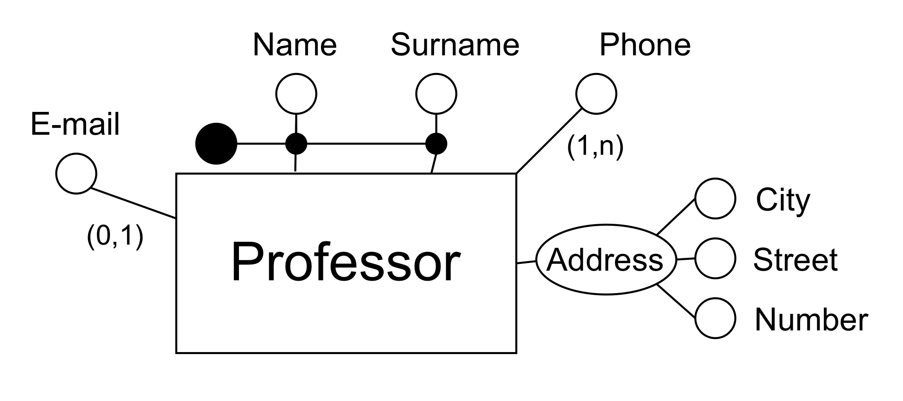
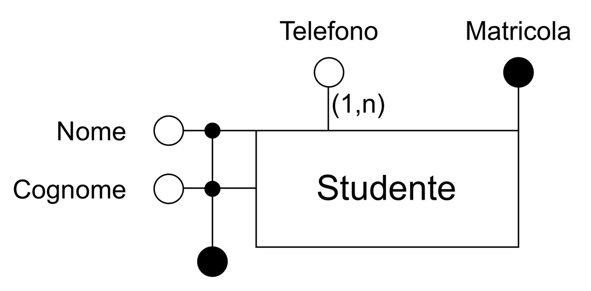
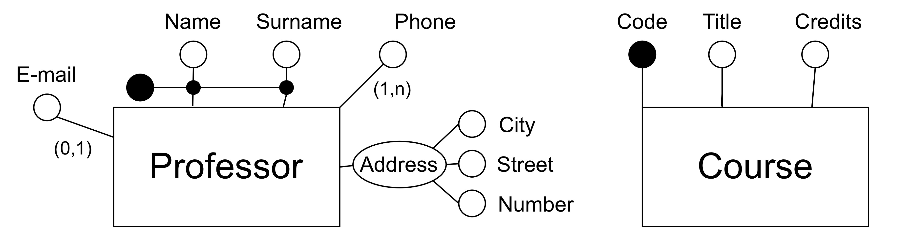
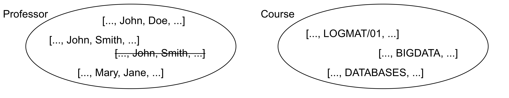
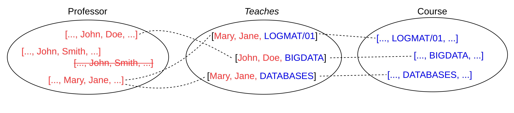
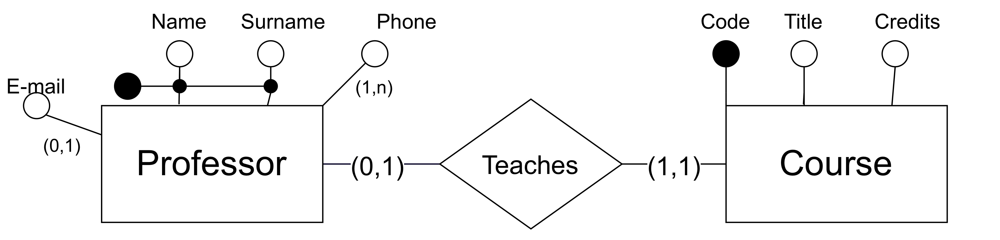
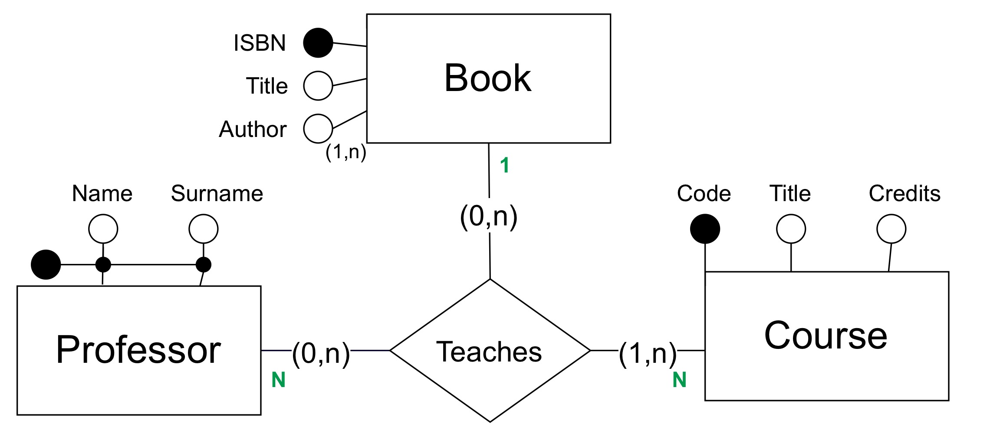
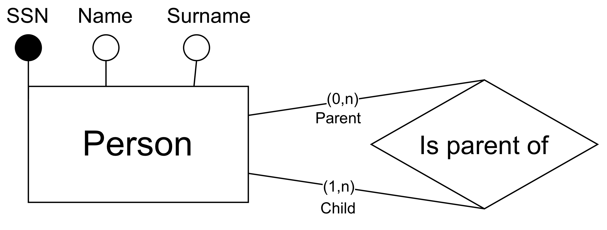
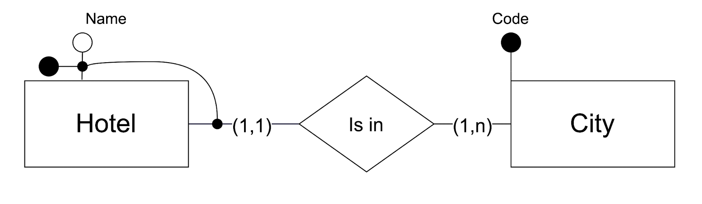

## Introduzione

L'informazione è rappresentata attraverso una forma minimale: il **dato**

dato
: collezione di materiali grezzi e disorganizzati riguardo un fenomeno

informazione
: si ottiene processando e interpretando i dati, organizzandoli in strutture e stabilendo collegamenti tra loro

conoscenza
: combinazione di informazione, intuizione e esperienza

I sistemi informativi sono fondamentali per supportare le decisioni aziendali e le organizzazioni. I dati sono spesso risorse strategiche perché sono molto stabili nel tempo rispetto a altre componenti (processi, tecnologie, umani)

Database

- collezione organizzata di dati per supportare attività di un'entità
- collezione di dati gestita da un **DBMS**

### DBMSs: Database Management Systems 

I DBMS sono un sistema sosftware che comprende:

- **database**: collezione di dati interrelati
- una serie di programmi per la gestione dei dati:
  - strutture definite per la conservazione
  - meccanismi per recuperare e modificare i dati
  - gestione dei conflitti e della sicurezza


#### File System to stare data

Volendo possiamo usare il file system per salvare i dati, ad esempio in un file csv

```csv
Name,Birthdate,Birthplace,Sex
Chris Pratt,6/21/79,Virginia,M
Chris Hemsworth,8/11/83,Melbourne,M
Ellen Barkin,2/16/64,Ohio,F
Emily Blunt,2/23/87,London,F
```

Tuttavia ci sono diversi svantaggi:

- **ridondanza**: i dati sono duplicati in più file per ogni dipartimento. Spreco di memoria e rischio inconsistenze
- **accesso inefficiente**: ogni nuova richiesta richiede un programma specifico (estrarre un tipo di dato nuovo rispetto altri)
- **isolamento dei dati**: file diversi e formati rendono difficile l'integrazione
- **sicurezza**: difficile permettere accesso parziale ai dati
- **gestione vincoli**: spesso i vincoli e i filtri sono nascosti nel codice dei programmi, difficile crearne di altri, difficile assicurarsi l'integrità
- **aggiornamenti atomici**: failure possono rendere i file inconsistenti
- **accesso concorrente** rischio di accesso concorrente di più utenti e conseguente inconsistenza

```{mermaid}
graph LR
    A("programma 1: esami studenti") --- B["archivio 1: dati studenti e esami"]
    C("programma 2: tasse studenti") --- D["archivio 2: dati studenti e tasse"]
```

#### DBMS per salvare i dati

Una soluzione a questi problemi è l'uso di un DBMS

Ottimo nei casi in cui:

- **grandi quantità di dati**: non possono essere caricati in memoria principale
- **dati globali e condivisi**: database utilizzato per molteplici scopi da molteplici utenti
- **dati persistenti**: il database esiste indipendentemente da utente e programmi

```{mermaid}
graph LR
    A("programma 1: esami studenti") --- C["Database studenti"]
    B("programma 2: tasse studenti") --- C["Database studenti"]
```

I principali vantaggi

- **no ridondanza**
- **assenza inconsistenza**
- **privacy**
- **efficienza**

La gestione della complessità DBMS sfrutta l'**astrazione**: significa organizzare i DBMS in livelli

#### Layer nei DBMS

**livello fisico**: come vengono salvati i dati su disco
**livello logico**: quali dati sono salvati e come sono rappresentati e relazionati
**livello esterno/di vista**: gestisce presentazione delle informazioni e dei programmi, può nascondere parte delle informazioni

**physical data independence**: posso modificare il livello fisico senza modificare il livello logico

**logical data independence**: tramite *views* posso modificare il livello logico senza modificare il livello esterno e viceversa

```{mermaid}
graph TD
    A[Livello esterno] --- B[Livello logico]
    B --- C[Livello fisico]

    A --- D
    B --- E
    C --- F
```

### Data models

Lo schema logico è descritto da un piccolo numero di strutture provviste da modelli di dati

Un **data model** descrive:

- i dati e la loro struttura
- relazione tra i dati
- vincoli

Ne esistono diversi modelli: relazionale, grafo, object-based, semistructured (XML), gerarchico

- modello gerarchico: organizzato ad albero
- modello a grafo: con nodi e archi
- modello relazionale: organizzato in tabelle

#### Relational model

I dati sono logicamente organizzati in **relazioni**, visualizzabili come **tabelle**.

Le tabelle rappresentano:
- schema
- istanza

è un modello **record-based**:

- le righe hanno un formato e lunghezza fissati
- ogni riga rappresenta un **record**
- ogni colonna un **attributo**

Ogni tabella ha una **chiave primaria** che serve a identificare unicamente ogni riga

è una rappresentazione logica, non determina come i dati sono fisicamente salvati

::: {.table-bordered}

| ID | name | dept_name | salary |
| ---| --- | --- | --- |
| 2222 | Einstein | Physics | 97000 |
| 1231 | Wu | Finance | 8999 |
| 1305 | Mozart | Music | 34000 |

:::

Le relazione tra record può essere rappresentata con valori corrispondenti in tabelle diverse (**JOIN**)

Un vincolo a una **chiave esterna (o riferita)** può garantire che il valore esista effettivamente

le relazioni sono espresse a livello logico, fisicamente non sono necessari dei puntatori

#### Differenti rappresentazioni

Si possono usare differenti modelli per rappresentare i dati (es. grafo vs relazionale) &rarr; vedi slide

logical data models
: sono astratti, non impongono vincoli fisici ma impongono vincoli sull'organizzazione dei dati

conceptual data models
: ancora più astratti, descrivono i dati indipendentemente dal modello logico, utili nella fase di progettazione del database

#### SQL - Structured Query Language

Uno dei vantaggi principali dei database relazionali è il loro supporto a SQL (Structured Query Language)

SQL è un linguaggio dichiarativo diviso in due parti:

- **DDL** (Data Definition Language): specifica lo schema del database
- **DML** (Data Manipulation Language): recupera e aggiorna il contenuto tramite *query*

Possiede una sintassi standardizzata

```sql
SELECT name
FROM instructor
WHERE salary > 97000
```

### Persone e DBMS

database administrator (DBA)
:gestisce il database, ne garantisce la sicurezza e l'integrità, gestisce backup e recovery

naive user
: usa il database tramite API semplificate

external developer
: comunica mediante linguaggio di programmazione e librerie

advanced user
: accede al database e al DBMS direttamente con DML

### Database system internals

Un database contiene:

- i **dati** stessi
- **indici**: strutture per velocizzare e migliorare l'accesso ai dati
- **data dictionary**: metadati che definiscono le strutture dei database
- **statistical data**: informazioni sulla quantità di dati, la loro distribuzione

Un DBMS implementa una serie di **sottomoduli** che gestiscono un aspetto specifico
- **storage manager**
- **query processor**

Lo **storage manager** è il modulo software che provvede all'interfaccia tra il basso livello del database e le applicazioni/query

- interagisce con file system, si occupa del salvataggio e del recupero dei dati, traduce comandi DML in comandi di basso livello file-system 

è composto da:
- **Authorization and integrity manager** (e.g., user privileges and physical integrity)
- **Transaction manager** (ensures that the ACID properties are satisfied), assicurando che il databse rimanga consistente
- **Buffer manager** (manages the main-memory area reserved for the DBMS)
- **File manager** (allocates space in primary and secondary memory and manages the data structures used to represent information)

Il **query processor** si occupa del **query processing** i cui step principali sono:
1. Parsing and translation
2. Optimization
3. Evaluation

Una query può essere eseguita in modi diversi (scan delle tabella, uso di un indice)

### Database design

L'architettura di un database dipende molto dal computer system sottostante: centralizzato, client-server, parallelo, distribuito

Il processo di design viene distinto in due fasi, cosa viene rappresentato e successivamente come

1. conceptual design
2. logical design
3. physical design

**conceptual design**: identificare e descrivere il dominio che il database modella, con tutti i requisiti. 

**databse design**: schema concettuale trasformato in uno schema logico basato su un modello logico, applicando regole, strutture, usando tecniche formali (es. normalization) per assicurarsi della buon bontà dello schema, scegliendo la specifica tecnologia DBMS

**physical design**: creazione dello schema fisico e dettagli basso livello (definizione indice, altre cose)

## Entry-relationship model

### Concetti preliminari

- insiemi (set) senza ripetizioni e ordine
- multinsiemi (multiset) con ripetizioni e senza ordine
- insieme delle parti (power set): insieme che include tutti i sottoinsiemi
- prodotto cartesiano

Nella prima fase di progettazione concettuale, il modello più usato è l'**Entity-Relationship model (E-R)**

Il modello entità-relazione descrive un dominio tramite:

- insiemi di entità
- insiemi di relazioni tra entità
- attributi

Ci sono diversi modi per rappresentarli, seguiremo la notazione di:
*Database Systems - Concepts, Languages and Architectures* by P. Atzeni, S. Ceri, S. Paraboschi, and R. Torlone

### Insiemi di entità (Entity sets)

entità
: oggetto che esiste nel dominio considerato ed è distinguibile da altri oggetti. Esiste indipendentemente dalle proprietà che gli associamo

entity set
: insieme di entità dello stesso tipo con le stesse proprietà

attributi
: proprietà condivise da tutti i membri di un entity set

Ogni attributo assume i valori dal dominio

Un sottoinsieme di attributi formano una **chiave** di un insieme di entità se i valori degli attributi identificano univocamente ogni entità

- conoscere questi valori identifica un'identità
- due entità diverse non possono avere gli stessi valori per tutti gli attributi della chiave

### Insiemi di entità

Esempio entità *Professore* con i seguenti attributi

- *nome* e *cognome*, che insieme formano la chiave
- *email* opzionale
- *cellulare*, molti valori
- *indirizzo*, attributo composto formato da
  - *città*
  - *via*
  - *civico*



- cerchio nero: chiave
- cerchio bianco: attributo
- rettangolo: entità
- parentesi nei lati: cardinalità relazione

Possibilità di più chiavi 



Per un'entità posso avere due chiavi che permettono l'identitificazione univoca, es: nome + cognome oppure numero matricola. In ogni caso posso scegliere una chiave primaria, che sarà quella usata per identificare l'entità

attributi possono essere *composti*

**proprietà insiemi di entità**:

- un insieme **non** può contenere due entità con gli stessi attributi chiave
- ogni set ha una chiave *banale* che consiste in tutti gli attributi
- un set può avere più chiavi

Esempi





### Insiemi di relazioni

relazione
: associazione tra più entità

insieme di relazioni (relationship set)
: $R \subseteq E_1 \times E_2 \times ... \times E_n$ è un insieme di relazioni tra $n \geq 2$ entità ($e_i$), ognuna disegnata dal corrispondente insieme entità $E_i$



In questo caso abbiamo 3 relazioni (linee tratteggiate) che assumiamo appartenere all'insieme relazioni *Teaches*

- *Professor*: insieme entità
- *Course*: insieme entità
- *Teaches*: insieme relazioni

In cui in abbiamo le relazioni:

1. (John Doe, BIGDATA)
2. (Mary Jane, LOGMAT/01)
3. (Mary Jane, DATABASES)

La relazione pertanto è una dupla (elemento insieme entità 1, elemento insieme entità 2)

#### Relazioni e attributi

Le relazioni possono avere attributi propri (per esempio per tracciare quando un professore inizia un corso)

- (John Doe, BIGDATA, 2023-01-01)

La relazione in ogni caso rimane definita dall'associazione tra entità, gli attributi sono solo informazioni aggiuntive

(immagine slide 19 - 2)

#### Cardinalità delle relazioni

In generale per una relazione binaria tra due insiemi, possiamo identificare le seguenti **cardinalità**:

- **1:1**: un'entità di un insieme è associata al massimo a un'entità dell'altro insieme e viceversa
- **1:N**: un'entità di un insieme può essere associata a più entità dell'altro insieme, ma ogni entità dell'altro insieme è associata al massimo a un'entità del primo insieme
- **N:1**: un'entità di un insieme può essere associata al massimo a un'entità dell'altro insieme, ma ogni entità dell'altro insieme può essere associata a più entità del primo insieme
- **N:M**: un'entità di un insieme può essere associata a più entità dell'altro insieme e viceversa

Un insieme di entità può avere partecipazione *totale* o *parziale* in un insieme di relazioni.

##### 1:1

(immagine slide 21 - 2)

##### 1:N

##### N:1

##### N:M

#### Notazione grafica degli insiemi di relazioni



Nelle parentesi abbiamo i vincoli di cardinalità

`(min, max)` indica il numero minimo e massimo di entità che possono partecipare alla relazione

le relazioni (indicate con un rombo) possono anche avere attributi propri, con la classica notazione a cerchio

#### relazioni tra più insiemi di entità (&gt;2)



notazione verde: elimina ambiguità 

- data una coppia (professor, course): **1** libro
- data una coppia (professor, book): **N** corsi
- data una coppia (course, book): **N** professori

(altro esempio slide)

#### Relazioni ricorsive e ruoli

**Relazione ricorsiva**: relazione tra entità dello stesso insieme $R \subseteq E_1 \times E_1$

esempio: relazione *è genitore di* tra entità *Persona*



se la relazione non è simmetrica, ogni ricorrenza può essere distinta da un **ruolo**

### Attributi derivati

un **attributo derivato** è un attributo il cui valore può essere calcolato a partire da altri attributi

(es: numero di corsi insegnati da un professore, calcolabile contando le relazioni *Teaches* in cui il professore partecipa)

Non vanno inseriti manualmente, ma una routine di update si occupa di mantenere i valori consistenti

**Notazione grafica**: cerchio tratteggiato

buona norma inserire nel diagramma ER delle note in cui si specifica come calcolare l'attributo derivato

### Insiemi di entità deboli

L'esistenza di un'entità debole dipende dall'esistenza di un'entità forte, che la identifica univocamente

L'entità debole non ha una chiave propria, ma la identifichiamo mediante l'entità forte a cui è associata e una chiave parziale

Ogni *weak identity set* ha un *corresponding identifying entity set*

L'identifying set possiede l'insieme di entità deboli che identifica, e la relazione tra i due insiemi è detta *identifying relationship*

**entità debole**: entità forte associata + chiave parziale

- il weak identity set ha partecipazione totale nella identifying relationship, con una cardinalità di 1
- l'identifying entity set può avere partecipazione parziale, la sua cardinalità può tipica è N
- eventuali attributi coinvolti nelle chiavi parziale devono avere cardinalità (1,1)
- catene di insiemi di entità deboli sono ammessi, dipendenza da più insiemi di entità forti è ammessa e più insiemi di chiavi parziali (vanno evitati cicli)

Notazione grafica: pallino nero che da chiave parziale tocca l'arco della relazione identificante



Esempio:

$$
\begin{array}{lc}
x = 1 & \text{condizione A} \\
y = 2 & \text{condizione B} 
\end{array} \right \} \text{risultato}
$$

$$
\begin{rcases}
x = 1 \\
y = 2
\end{rcases} \Rightarrow z = 3
$$