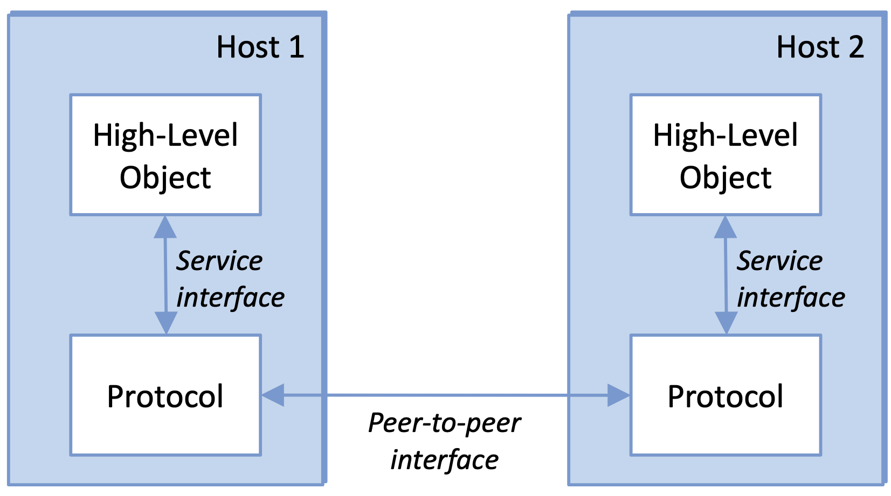

link del libro online: [Computer Networks: A System Approach](https://7e.systemsapproach.org)

## Foundations

Un **network** è composto da:

- **nodi** indipendenti
- **informazioni** scambiate
- **canali di comunicazione**

L'obiettivo è quello di compiere dei compiti che non potrebbero essere svolti da un singolo nodo.

Caratteristiche di un rete di calcolatori:

- scopo generale (non ottimizzato per una specifica applicazione)
- flessibilità e apertura (possibilità di aggiungere nuove caratteristiche e nuove applicazioni)

network
: un netword è un'entità composta da 2 o più nodi o 2 o più reti connesse tramite un nodo

un network è una gerarchia di network &rarr; problema di indirizzare i nodi nelle diverse reti

### Cost-effective resource sharing

...

### Network Architecture and Protocols

Architettura a livelli: ogni livelli aggiunge nuove funzionalità

::: {.table-bordered}

| Application programs|
| :---: |
| Process-to-process channels|
| Host-to-host connectivity |
| Hardware |

:::

Interfacce



#### Protocolli

Un protocollo definisce un'interfaccia tra i livelli dello stesso sistema e con i livelli di un sistema paritetico. 

Ogni oggetto protocollo ha due interfacce

- **interfaccia di servizio**: operazioni su questo protocollo
- **interfaccia peer-to-peer**: messaggio scambiati tra pari

A volte ci si riferisce sia alle specifiche dell'interfaccia peer-to-peer che ai moduli che la implementano 

specifiche del protocollo: prosa, pseudocodice, modello a stati finiti
inter
interadoperabilità: quando due protocolli implementano le specifiche accuratamente
IETF (Internet Engineering Task Force): definisce i protocolli

#### Grafo dei protocolli

Un grafo dei nodi

- nodi: protocolli
- archi: relazioni di dipendenza tra protocolli

#### Incapsulamento

Ogni livello necessita di alcune informazioni per implementare funzioni verso i livelli superiori

```{mermaid}
flowchart TD
    A[Data] --> B[Protocollo]
    B --> C[P Header &vert; Data]
```

Un messaggio intero **PDU** (Protocol Data Unit) è composto da:

- **header**: informazioni di controllo
- **payload** o **SDU Service Data Unit**: informazioni da trasmettere

Il PDU diventa un SDU per il livello inferiore, che aggiunge un proprio header e lo invia al livello inferiore successivo.

Generalmente per i protocolli è sufficiente leggere l'header, i livelli superiori leggono il payload e ignorano l'header.

(immagine slide 1 - 48)

### ISO OSI Architecture

ISO (International Organization for Standardization) è un'organizzazione internazionale che sviluppa e pubblica standard internazionali.

OSI (Open Systems Interconnection) è un modello di riferimento per la progettazione di protocolli di rete.

(immagine dei livelli)

Si tratta di una struttura standard per progettazioni di protocolli

- **livelli superiori**
- **livelli inferiori**

1. **Livello fisico**: trasmissione di bit su un canale di comunicazione
2. **livello di collegamento dati**: aggrega i bit in *frame* e gestisce gli errori di trasmissione
3. **Livello di rete**: indirizzamento e routing dei pacchetti
4. **Livello di trasporto**: fornisce un servizio di trasferimento dati tra applicazioni degli host
5. **Livello di sessione**: gestisce le connessioni tra applicazioni
6. **Livello di presentazione**: traduce i dati in un formato comprensibile per l'applicazione
7. **Livello applicazione**: fornisce servizi specifici per le applicazioni

Implementazione

- primi 3 livelli: su tutti i nodi, anche intermedi
- ultimi 4 livelli: solo sugli host


####  Repeater (livello fisico)

connette due media fisici dello stesso tipo, condividendo singoli bit.

I bit sono decodificati da un lato e ricodificati dall'altro lato.

#### Bridge (livello di collegamento dati)

Connette due collegamenti(?)

Un *bridge* scambia *frame*, i quali vengono controllati e inoltrati. I frame header non vengono alterati, ma la codifica fisica può differire.

Uno *switch* è un bridge con più porte

#### Router (livello di rete)

connette due segmenti di rete

trasmette **pacchetti** con un network header non cambiato, ma rimpiazza il frame header

#### Proxy (livello di trasporto)

Traduce *messaggi* da host differenti 

### TCP/IP Architecture (Internet Architecture)

Due livelli principali:

- **livello applicativo**: Application, Presentation, Session
- **livello di interfaccia di rete**: Data Link, Physical

Definito da IEFT

- **non implica una stratificazione rigida**
- **forma a collo di bottiglia**
- nuovo protocollo richiede specifiche e minimo un'implementazione rappresentativa (meglio 2)

Limiti della stratificazione:

- non tutti i servizi 
- alcuni servizi sono intrisecamente legati a più livelli (es. sicurezza)

### Network API

Interfaccia messa a disposizione dalla rete, ovvero interfaccia che il sistema operativo fornisce al suo sottosistema di rete (componente del kernerl che gestisce le comunicazioni di rete)

### Socket API

Ogni protocollo fornisce un certo insieme di servizi, mentre l'API fornisce una sintassi con la quali questi servizi possono essere invocati.

Il *socket* è il punto di incontro tra processo locale si collega alla rete, nonché interfaccia tra applicazione e rete.

L'interfaccia definisce le operazioni per

- creare, collegare il socket alla rete, usare il socket per inviare e ricevere messaggi, chiudere il socket

può essere

(...)

### Client-Server Model con TCP

(...)

### Performance

La performance di una rete può essere misurata in termini di:

- **throughput**: numero di bit trasmessi per unità di tempo
- **ritardo**: tempo impiegato da un bit per viaggiare da un host all'altro

Delle volte si usa **bandwidth** come sinonimo di throughput, ma in realtà indica l'ampiezza della banda di frequenza

**round-trip time (RTT)**: tempo impiegato da un bit per viaggiare da un host all'altro e tornare indietro (erroneamente chiamato *ping time*). Proprietà specifica di due host, non di rete!

$$ \text{RTT}_{A \to B} = L_{A \to B} + L_{B \to A} $$

con connessione simmetrica: $L_{A \to B}$ = $L_{B \to A} \implies 2 \cdot L_{A \to B}$

#### Latenza

$$
\text{latenza} = \text{tempo di propagazione} + \text{tempo di trasmissione} + \text{tempo di coda}
$$

dove:

- **tempo di propagazione**: $\frac{\text{distanza}}{\text{velocità di propagazione}}$ del segnale
- **tempo di trasmissione**: tempo per trasmettere il messaggio 
- **tempo di coda**: tempo speso all'interno di un nodo (computer, switch, router) per attendere che il messaggio venga processato e trasmesso

In una rete, la latenza è la somma di tutte le latenze

$$ L = \sum_{i=1}^{n} L_i $$

- messaggio grande &rarr; tempo di trasmissione domina
- messaggio piccolo &rarr; tempo di propagazione domina
- percorso fissato &rarr; propagazione/trasmissioni costante, cambia il tempo di coda
- cambia percorso &rarr; cambia la latenza

#### Jitter

Il jitter è la varianza della latenza

Generalmente generato dalle code degli switch

problema per streaming audio video

#### Capienza canale

(immagine 1.96)

capienza dei dati contemporaneamente presenti nel canale è pari a

$$ Delay \cdot throughput $$

ovvero numero di bit trasmessi prima che arrivi il primo bit al destinatario