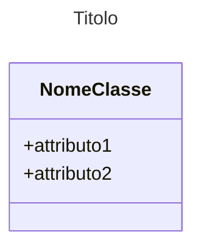
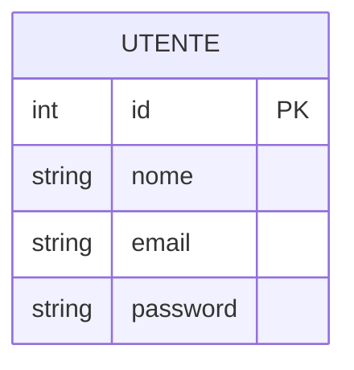

Appunti per sintassi di Mermaid.js per usare diversi grafici

| Tipo di diagramma | Utilizzo |
| :--- | :--- |
| [Flusso](#flowchart) | Mappare processi step-by-step, algoritmi, alberi decisionali e flussi di lavoro aziendali. |
| [Entità-Relazione](#erDiagram) | Progettare database, modellare strutture dati e definire relazioni (1:N, N:M) tra tabelle. |
| [Sequenza](#sequenceDiagram) | Illustrare lo scambio di messaggi e le interazioni temporali tra utenti, sistemi o API. |
| [Gantt](#gantt) | Pianificare progetti, tracciare scadenze, roadmap temporali e dipendenze tra attività. |
| [Stato](#stateDiagram-v2) | Descrivere il ciclo di vita e i cambi di stato di un oggetto (es. il flusso di un ordine da "creato" a "spedito"). |
| [Classi](#classdiagram) | Documentare la struttura del codice nella programmazione a oggetti (OOP), mostrando classi, attributi e metodi. |
| [Torta](#pie) | Rappresentare la composizione percentuale di un insieme di dati direttamente nel testo. |
| [Linee/Barre](#xychart-beta) | Mostrare andamenti temporali o confronti numerici semplici senza usare software di grafici esterni. |
| [Quadranti](#quadrantChart) | Categorizzare elementi in quattro aree per analisi strategiche (es. priorità dei task, matrici sforzo/impatto). |
| [Git](#gitGraph) | Rappresentare visivamente la cronologia dei commit, la creazione di branch e i merge in un flusso Git. |


## Diagrammi di flusso (flowchart) {#flowchart}

• Utilizzo: Mappare processi aziendali, algoritmi di programmazione, alberi decisionali e logiche step-by-step.
• Caratteristiche: È il più flessibile. Permette di forzare l'orientamento (TD dall'alto in basso, LR da sinistra a destra) e supporta diverse forme per i nodi (rettangoli, rombi per le decisioni, cerchi).

## Diagrammi classe (class) {#class}

• Utilizzo: Programmazione orientata agli oggetti (OOP) e ingegneria del software (UML).
• Caratteristiche: Rappresenta la struttura del codice mostrando classi, metodi, attributi e le relazioni di ereditarietà o composizione tra di esse.

### Creare una classe




## Diagramma entità-relazioni {#erDiagram}

• Utilizzo: Progettazione di database relazionali (SQL), modellazione dei dati e architetture informative.
• Caratteristiche: Mostra tabelle (entità), i loro attributi interni (campi, chiavi PK/FK) e i legami logici di cardinalità (1:1, 1:N, N:M) tramite una sintassi dedicata.

Ogni diagramma ER deve iniziare con parola chiave: `erDiagram`

### Definizione Entità e Attributi

per dichiarare entità: scrivi semplicemente il nome senza spazi

per aggiungere attributi: usare le parentesi graffe `{}` indicando
- tipo
- nome della colonna
- eventuali chiavi (PK = primarie, FK = esterne)


```mermaid
NOME_ENTITA {
    tipo_dato nome_attributo PK "Commento opzionale"
    tipo_dato altro_attributo FK
    tipo_dato attributo_semplice
}
```

esempio:



che risulta

```{mermaid}
erDiagram
    UTENTE {
        int id PK
        string nome
        string email
        string password
    }
```

### Connessioni e cardinalità

relazioni tra entità rappresentate da

- linea centrale 
  - `--` : relazione identificante
  - `..` : relazione non identificante
- simboli di cardinalità che racchiudono la linea centrale
  - `0`= zero
  - `|`= uno
  - `}`= molti

Di conseguenza

relazioni identificanti

- `||--||` &rarr; 1 obbligatorio a 1 obbligatorio
- `||--o{` &rarr; 1 obbligatorio a 0 o molti
- `||--|{` &rarr; 1 obbligatorio a 1 o molti
- `}|--|{` &rarr; 1 o molti a 1 o molti

relazioni non identificanti

- `||..||` &rarr; 1 opzionale a 1 opzionale
- `||..o{` &rarr; 1 opzionale a 0 o molti
- `||..|{` &rarr; 1 opzionale a 1 o molti
- `}|..|{` &rarr; 1 o molti a 1 o molti

esempio:

```mermaid
CLIENTE ||--o{ ORDINE : "effettua"

```

risultato

```{mermaid}
erDiagram 
    CLIENTE ||--o{ ORDINE : "effettua"
```

::::: {layout-ncol="4"}

::: {}
### Relazione Uno a molti (1:N)
```{mermaid}
erDiagram
    AUTORE ||--|{ LIBRO : "scrive"
    
    AUTORE {
        int id_autore PK
    }
    LIBRO {
        string isbn PK
    }
```
:::

::: {}
### Relazione Uno-a-Molti Opzionale (1:0..N)
```{mermaid}
erDiagram
    CLIENTE ||--o{ ORDINE : "effettua"
    
    CLIENTE {
        int id_cliente PK
        string nome
    }
    ORDINE {
        int id_ordine PK
        date data_creazione
    }
```
:::

::: {}
### Relazione Molti-a-Molti (N:M)
```{mermaid}
erDiagram
    STUDENTE }o--o{ CORSO : "frequenta"
    
    STUDENTE {
        int id_studente PK
        string nome
    }
    CORSO {
        int id_corso PK
        string titolo
    }
```
:::

::: {}
### Relazione Uno-a-Uno (1:1)
```{mermaid}
erDiagram
    UTENTE ||--|| PROFILO : "ha"
    
    UTENTE {
        int id_utente PK
        string username
    }
    PROFILO {
        int id_profilo PK
        int id_utente FK
    }
```
:::

:::::

## Diagramma di Sequenza {#sequenceDiagram}

• Utilizzo: Illustrare come diversi oggetti, sistemi o utenti interagiscono tra loro nel tempo (es. chiamate API tra client e server, passaggi di autenticazione).
• Caratteristiche: Si sviluppa verticalmente come una linea temporale, mostrando attori ("Lifelines") e messaggi di andata (linee continue) e ritorno (linee tratteggiate).

## DIagramma di Gantt {#gantt}

• Utilizzo: Gestione dei progetti (Project Management), pianificazione di roadmap e tracciamento delle scadenze delle attività.
• Caratteristiche: Visualizza barre temporali orizzontali suddivise per sezioni, evidenziando le dipendenze tra i task, le date di inizio/fine e lo stato di avanzamento

## Diagramma di Stato {#stateDiagram-v2}

• Utilizzo: Descrivere il ciclo di vita di un oggetto o sistema che cambia comportamento in base agli eventi (es. lo stato di un ordine: In attesa \(\rightarrow \) Pagato \(\rightarrow \) Spedito).
• Caratteristiche: Mostra gli stati (nodi) e le transizioni (frecce con eventi) che causano il cambio di stato

## Grafici dei dati

• Utilizzo: Reportistica rapida all'interno di documenti di testo o presentazioni senza usare strumenti esterni.
• Grafici inclusi: Diagrammi a torta (pie), grafici a linee (xychart-beta) e mappe a quadranti (quadrantChart) per analisi strategiche (es. Matrice SWOT).

### Grafico a torta {#pie}

### Grafico xy {#xychart-beta}

### Quadranti {#quadrantChart}

## Grafici git {#gitGraph}
